# Dev journey: Per My Last Email

How a satirical office game went from "can you plan a game for me?" to a public v1 in about a day (24 to 25 Nov 2026), built with Claude Code. Screenshots are phone size (390px) and taken with `tools/capture_journey.py`, so every future version can be compared the same way.

| Stage | What it was | Events | Endings | Art |
|---|---|---|---|---|
| 1. Vertical slice | Text cards, stats, evidence log, HR stub | 8 | 5 | None |
| 2. Art pass | Hand-coded SVG portraits and scenes | 8 | 5 | 6 portraits, 6 scenes |
| 3. Real story | Bystander arc, Marcus, strikes, the call, 4 acts | 47 | 8 | 10 portraits, 9 scenes |
| v1 | Self-playtest loop, minigame, public release | 49 | 8 | + minigame |

## Stage 0: Plan

- Started broad: genre options (arcade, platformer, puzzle, story/sim), purpose (fun first, portfolio later), scope (a weekend).
- Picked **story/sim** about office life and a workplace bully, in satire (the "office game" genre).
- Wrote `GAME.md` before any code: core loop, stats, evidence log, endings, folder ownership.
- **Fictionalised from day one.** A parody of a real employer's name was rejected (identifiable, legal and hiring risk). The company became **Celestial Pte Ltd**, named after a meeting room only the old team would recognise.
- Planned a multi-agent split (writer, systems, art, reviewer). In practice the whole thing fit in one session, so no sub-agents were used. At this size the coordination cost wasn't worth it.

## Stage 1: Vertical slice (no art)

Not preserved as screenshots (git started at v0). What it was:
- `src/engine.js`: pure logic with no DOM, so the same code runs in the browser and in Node.
- 8 sample events, 4 stats, an evidence log, a stub HR meeting, 5 endings.
- First Node smoke test, 1,000 runs per policy: random play reached the best ending 22% of the time, "smart" play 100%. Too easy, but the loop worked.

## Stage 2: Art pass

All art is hand-written SVG. No image API, nothing to pay for, and it scales on any screen.

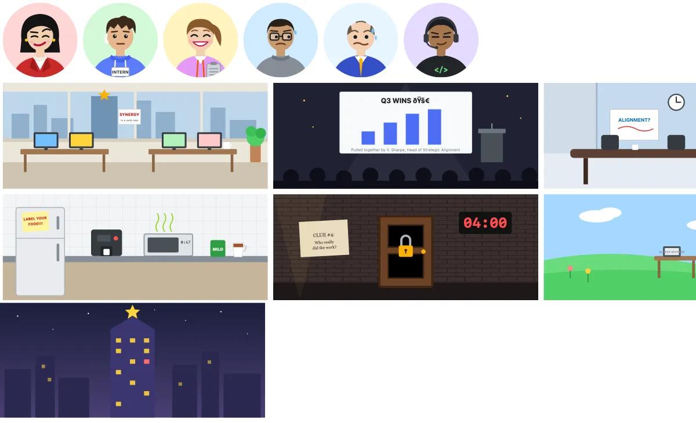

Second batch, added as the real story came in (Marcus, the CEO, Gordon, plus the 9:47pm call, restroom and dinner scenes):

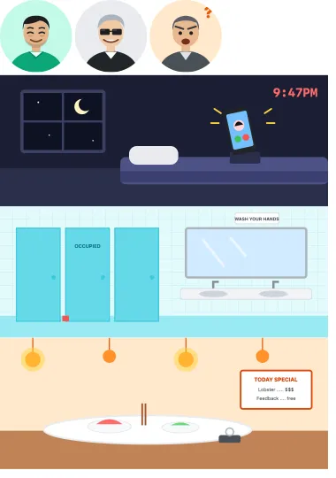

## Stage 3: The real story

Pin Xiu fed in memories one at a time; each became one or more event cards, logged in a private (gitignored) inbox.

Key design turns:
- **Bystander, not victim.** The player is a junior who is also the bully's "favourite", watching her target a new lead (Marcus). The core question became: stay a bystander, or become a witness?
- **The 10 strikes.** Marcus's real rule ("if she hits ten, I resign") became a hidden meter. Helping him buys time, looking away costs strikes.
- **The climax is a phone call.** First draft had the player submitting evidence to HR. Pin Xiu corrected it: she only told her boss her point of view. That made a better climax: her boss assumed she was close to the bully, so her word carried extra weight.
- **Endings from real alternatives:** the bully resigning first, the player resigning first, Marcus hitting strike ten.

Human corrections that changed the game (Claude got these wrong first):
- The dinner where the boss heard the truth was a peer's, not the bully exposing herself.
- A colleague turned down an outside offer because it was a lowball, not out of loyalty.
- Two CEO town hall quotes happened after the bully left, so they moved to a future Season 2.
- "The storyline feels jumbled" led to a fixed story spine: random satire cards had been landing out of order.

The fix: 4 acts with fixed beats per week and random satire filling the gaps.

| Title | Act screen | First card |
|---|---|---|
| 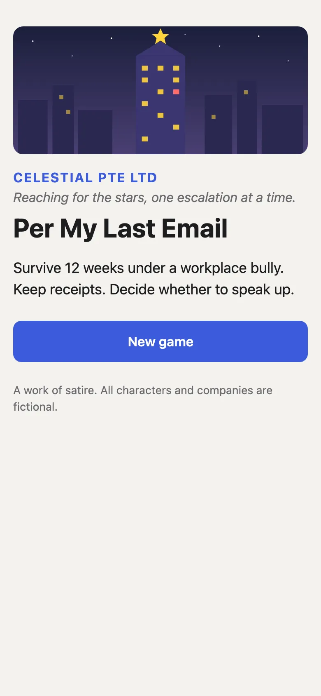 |  |  |

| Mid-game | The call | Ending |
|---|---|---|
| 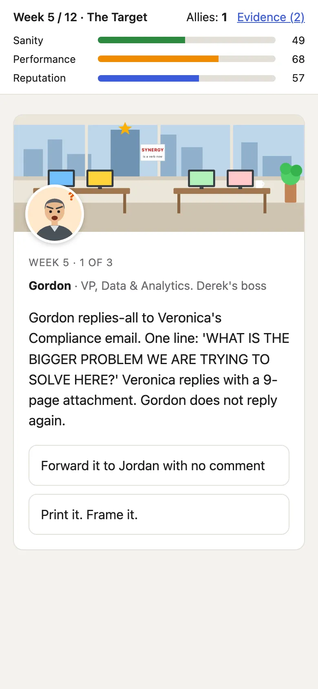 | 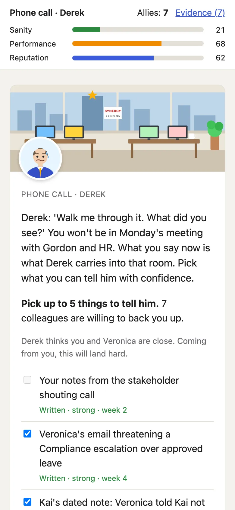 | 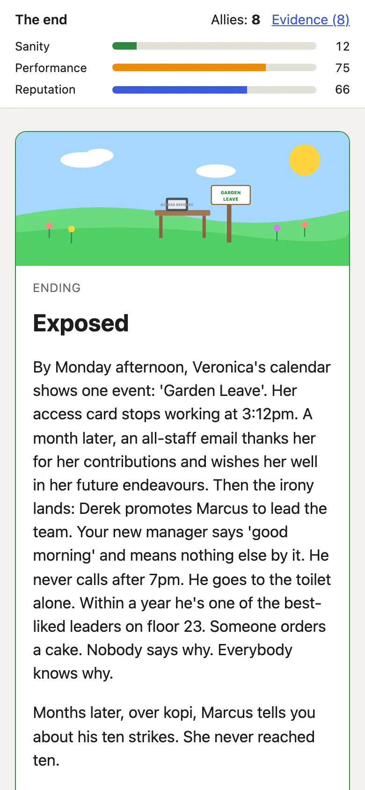 |

## v1: Self-playtest loop and release

Claude played and reviewed the game in 5 rounds (transcript read-throughs, simulation, browser tests):
1. **Pacing:** the "10 strikes" reveal moved before the climax; a Friday tension beat added; a PIP event made the "Managed Out" ending reachable.
2. **Visible systems:** Marcus's strike meter appears once he tells you about it; an endings gallery on the title screen drives replays.
3. **Built to scale:** `tools/validate.mjs` checks every event (broken links, missing art, flags nothing sets) and blocks the build on errors.
4. **First minigame:** Escape to Nebula, a top-down stealth run with a sight cone blocked by desks. Plug-in system so each future minigame is one file.
5. **Browser tests:** the first minigame layout was likely unwinnable; patrol and sight range were eased until a scripted route could win.

Balance after tuning (`tools/simulate.mjs`, 2,000 runs per playstyle):

| Playstyle | Most common endings |
|---|---|
| Smart | Exposed (true ending) ~90%+ |
| Random | Failing Upward 38%, Graceful Exit 18%, Strike Ten 14%, You Resign 12%, Pre-emptive Strike 9%, Burnout 4%, Managed Out 3%, Exposed 2% |
| Self-care | You Resign ~58%, Failing Upward ~42% |

| Title + gallery | Act screen | First card |
|---|---|---|
|  | 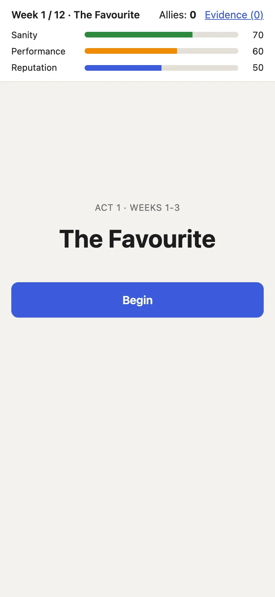 | 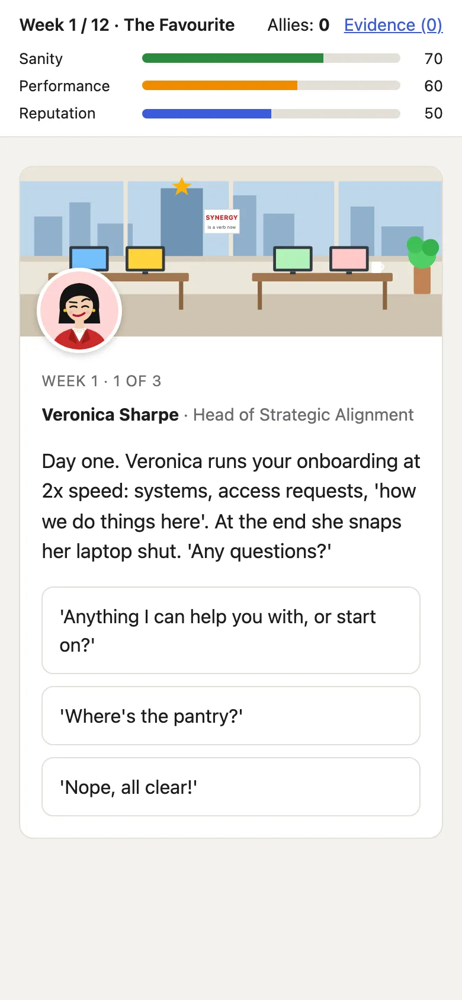 |

| Mid-game | The call + strike meter | Ending |
|---|---|---|
| 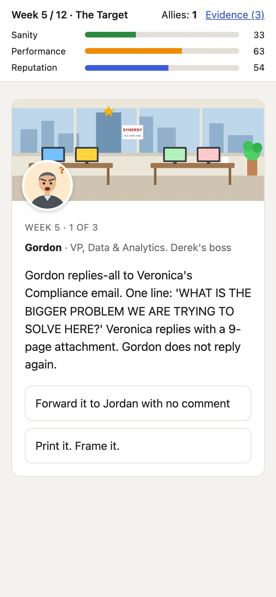 | 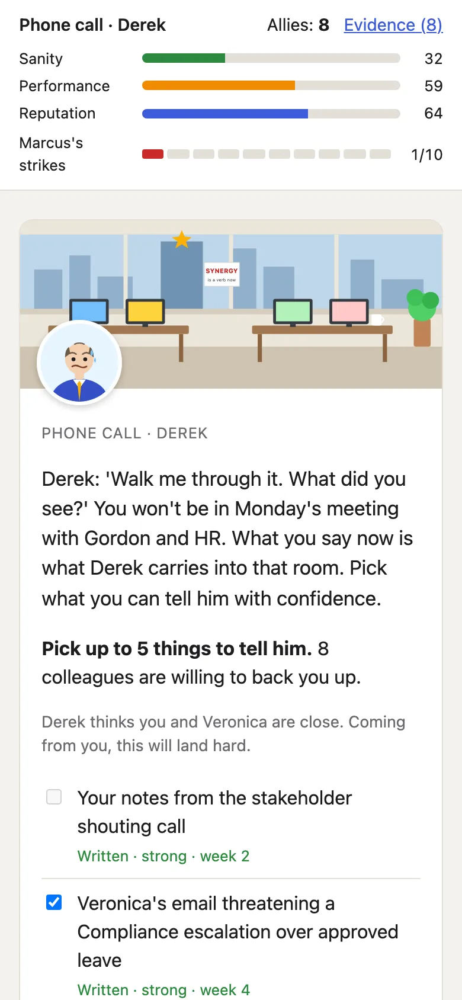 | 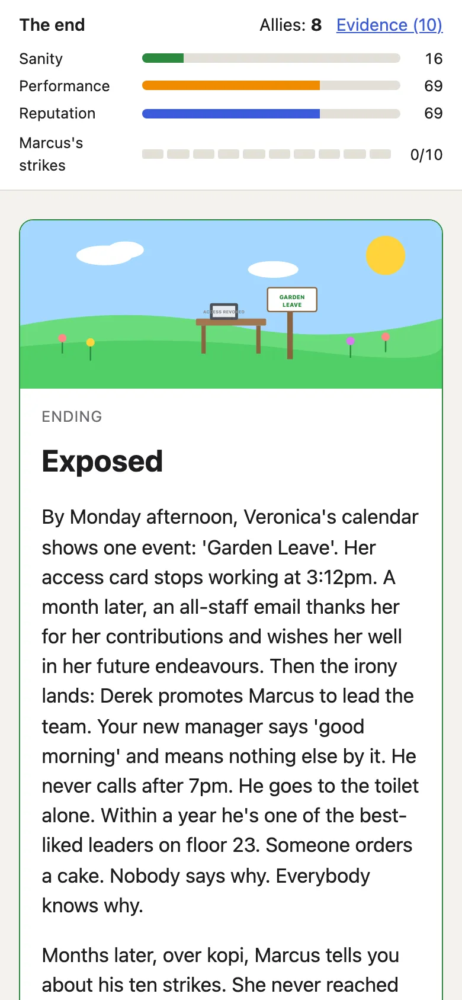 |

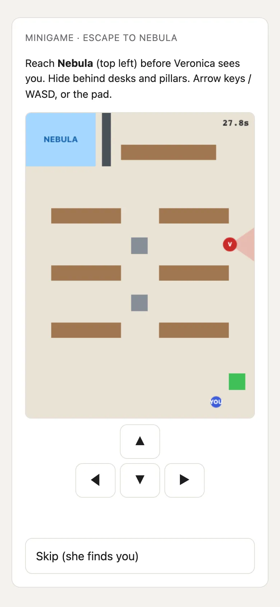

Released 25 Nov 2026: single-file build on Vercel, public repo, portfolio page with roadmap.

## Who did what

- **Pin Xiu:** the idea, every real-life story beat, tone (satire), the bystander framing, corrections to the story, the call on what's public, playtesting.
- **Claude Code:** design doc, engine, UI, SVG art, event writing from her notes, balance simulation, validator, minigame, self-playtest loop, deploys.

## Next

See the roadmap in [GAME.md](../GAME.md): v2 "proper game" (tutorial, more minigames, real trade-offs, sound, human playtests), v3 RPG-lite (a walkable floor 23), Season 2 "After Veronica". Each release gets a new `docs/journey/<version>/` capture.
